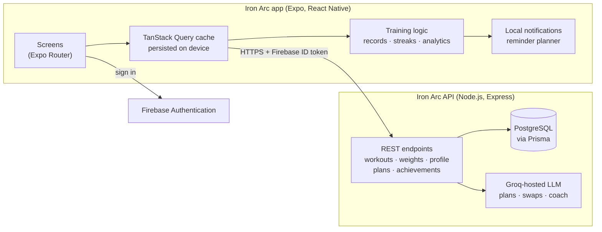

<div align="center">

# Iron Arc

**A strength-training companion for Android.**
Log lifts in seconds, see real progress, and follow an AI-built plan that fits your week.


<!-- Screenshots: add PNGs (about 1080×2400) to docs/screenshots/ with these names. -->


</div>

---

## Contents
- [Why Iron Arc](#why-iron-arc)
- [Features](#features)
- [Engineering highlights](#engineering-highlights)
- [Architecture](#architecture)
- [Tech stack](#tech-stack)
- [Getting started](#getting-started)
- [Project structure](#project-structure)
- [Testing](#testing)
- [Roadmap](#roadmap)
- [Author](#author)

---

## Why Iron Arc

Most workout apps either make logging slow or turn progress into a wall of numbers. Iron Arc is built around three questions lifters actually ask:

1. **What did I do last time?** Every set starts from your previous session, so logging is a tap, not a form.
2. **Am I getting stronger?** Records are recognised the moment you lift them, and every exercise has its own progress chart.
3. **Am I training enough, and evenly?** A weekly goal built from your own training days, and a body map showing which muscles got the work.

On top of that sits an AI plan generator and coach that build from what you've already told the app, so no question is asked twice.

---

## Features

### Logging
- **Fast set logging:** weight and reps prefilled from last time, one tap to complete a set, a rest timer that alerts even with the app closed.
- **Smart helpers:** a bar + plates calculator for barbell lifts, a one-tap default rep count, equipment hints ("bar + plates", "one dumbbell", "one side's stack").
- **Personal records as you lift:** heavier for the reps, more reps at the same weight, or a stronger estimated one-rep max.
- **Backdated logging** that compares against your history as it stood on that day.
- Per-exercise notes, editing past workouts, swipe to delete with undo.

### Progress
- **Home:** today's session, weekly goal ring, streak, recent records and body-weight snapshot.
- **History:** month calendar, sessions by day with their top set, CSV and PDF export.
- **Analytics:** activity by day, week or month; new records and "within reach" targets; a front-and-back **body map** coloured by weekly sets per muscle group; best lifts; a progress chart for every exercise.
- **Body weight:** quick logging, trend chart and an optional target.
- **Achievements:** 28 badges for consistency, volume, records and variety, with an unlock celebration.

### AI plans
- **Built from your profile:** training days, session length, equipment, experience and areas to go easy on.
- **Day-by-day view:** sets × reps, targets or your last set, rest times, one-tap exercise swaps, and "start this session" straight into the log.
- **Plan coach:** chat to adjust the plan ("make it 3 days a week", "shorter sessions").

### Everyday polish
- **Reminders that respect your schedule:** training-day reminders, a weekly-goal check only when it matters, a comeback nudge, a Sunday review and a weigh-in reminder.
- **Settings that save instantly**, kg/lb throughout, Google or email sign-in.
- **Resilient networking:** cached data stays usable while the server wakes up or the network drops, with honest status messages.

---

## Engineering highlights

Decisions that shaped the app, and the problems they solve.

- **One personal-record rule, everywhere.** A set is a record if it beats the heaviest earlier weight at the same or more reps, *or* beats every earlier estimated 1RM (Epley). The same rule drives the logging banner, History badges, Analytics stars and the server's achievement badges, with unit tests on both sides, so the app never contradicts itself.
- **Logging that survives anything.** The session lives in a local draft saved to device storage as you go; closing the app mid-workout loses nothing. Finishing sends the whole session in **one batch request** with a duplicate guard, so a timeout and retry can't save it twice.
- **Deletes with a real undo.** Deleting a workout hides it immediately and holds the server call for a short undo window (5 s); "Undo" cancels it before anything is lost.
- **History as it was.** Backdated sessions compare against an "as of" view of your history, so "last time" and record checks match that day, not today.
- **Reminders that never nag about done work.** A pure planner schedules the next 14 days of local notifications (at most one nudge a day) and re-plans whenever you log, change settings or open the app. Tapping a reminder opens the right screen.
- **Fitting the AI to its budget.** The plan coach sends one compact week instead of the whole multi-week plan, cutting the prompt from about 20,600 to 1,300 tokens to fit the model provider's per-minute limit. The AI returns only the changed days, which the server validates and applies.
- **Honest status everywhere.** Every status text is computed from real data; loading screens show what the AI is working from instead of a fake percentage.
- **One design system.** Every colour, size and motion value comes from `theme/tokens.ts`, and screens are built from shared components. Buttons take a tap anywhere in their visible box, and animations respect the system's reduced-motion setting.

---

## Architecture



- **The server is the source of truth.** The app keeps a persisted query cache so screens open instantly and stay readable offline; every write goes through the API.
- **Training logic runs on the device** from the cached history, so every screen shows the same numbers. Badges are evaluated on the server with the same rules.
- The backend lives in its own repository: [Iron Arc Backend](https://github.com/pushpanathDev/Iron_Arc_Backend_V2).

---

## Tech stack

| Area | Technology |
|---|---|
| App | Expo SDK 54, React Native 0.81 (New Architecture), React 19, TypeScript |
| Navigation | Expo Router (file-based, typed routes) |
| Data | TanStack Query v5 with an AsyncStorage-persisted cache |
| Auth | Firebase Authentication (email and Google Sign-In) |
| Motion and graphics | Reanimated 4, react-native-svg, Expo Linear Gradient |
| Notifications | expo-notifications (local, scheduled on device) |
| Testing | Jest |
| Backend | Node.js, Express, Prisma, PostgreSQL (Supabase), Render |
| AI | Groq-hosted LLM for plan generation, recalibration, swaps and the plan coach |

---

## Getting started

### Prerequisites
- Node.js 20 LTS or newer
- Android Studio with an emulator, or an Android phone with USB debugging
- A running [Iron Arc Backend](https://github.com/pushpanathDev/Iron_Arc_Backend_V2) (local or deployed)
- A Firebase project with Email/Password and Google sign-in enabled

### Setup
```bash
git clone https://github.com/pushpanathDev/Iron_Arc.git
cd Iron_Arc
npm install
cp .env.example .env   # then fill in the values below
```

| Variable | Purpose |
|---|---|
| `EXPO_PUBLIC_BACKEND_URL` | Base URL of the Iron Arc API (e.g. `http://10.0.2.2:3000` from the Android emulator) |
| `EXPO_PUBLIC_GOOGLE_WEB_CLIENT_ID` | OAuth web client ID used by Google Sign-In |
| `EXPO_PUBLIC_PERF_LOG` | Optional: `1` prints screen performance timings in development |

Firebase's client settings live in `firebase/config.js`, and the Android app config in `google-services.json`; replace both with your own project's values.

### Run
```bash
npx expo run:android   # build and install the development build
npx expo start         # start Metro for an installed development build
```

> Local notifications and Google Sign-In need a development build; they don't run in Expo Go.

### Scripts
| Command | What it does |
|---|---|
| `npm start` | Start the Metro bundler |
| `npm run android` | Build and run the Android development build |
| `npm test` | Run the Jest test suite |
| `npm run lint` | Lint with ESLint (Expo config) |

---

## Project structure

```
app/                 Screens (Expo Router)
  (tabs)/            Home, Weight, Analytics, History, Profile
  log/               Exercise picker, logging session, edit workout
  exercise/          Per-exercise progress
  ai-plan, plan-detail, plan-chat, achievements, notification-settings, ...
components/          UI by feature (log, history, analytics, plans, profile, ...)
  ui/                Shared building blocks (Button, Sheet, Stepper, ConfirmDialog, ...)
hooks/               Data hooks (TanStack Query), logging draft and delete queue
utils/               Pure training logic: records, analytics, plan parsing, weight entry
notifications/       Reminder planner (pure) and scheduling service
services/api.ts      Typed API client
theme/               Design tokens and theme
__tests__/           Unit tests for the logic above
```

---

## Testing

```bash
npm test
```

The suite covers the logic the app depends on: personal-record rules, streaks and weekly goals, analytics periods and muscle balance, logging drafts and batch saves, the delete queue, plan parsing, reminder planning and the weight-entry helpers.

---

## Roadmap

- **Coach v2:** a context-aware AI coach that knows your recent training, records and trends, with lasting conversation memory.
- **Plan-aware reminders** that name the day's session.
- **Pro tier** for AI features, starting with a mock checkout for user testing.

---

## Author

Designed and built by **Pushpanath**.

- App: [github.com/pushpanathDev/Iron_Arc](https://github.com/pushpanathDev/Iron_Arc)
- Backend: [github.com/pushpanathDev/Iron_Arc_Backend_V2](https://github.com/pushpanathDev/Iron_Arc_Backend_V2)
- Notes and write-ups: [github.com/pushpanathDev/Summaries](https://github.com/pushpanathDev/Summaries)

This repository doesn't include a license yet.
